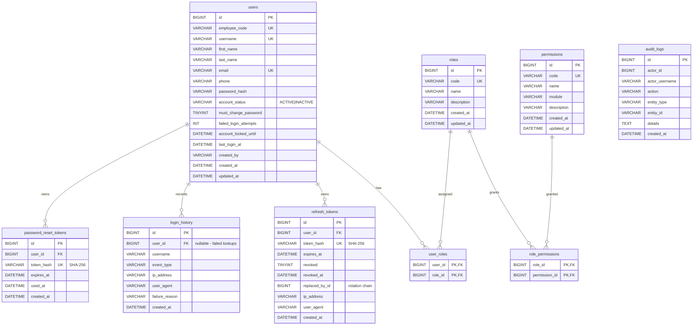

# PCC Identity Service

Authentication & User Management microservice for the **PCC Cameroon — Property & Land Management System**.

| | |
|---|---|
| Group / Artifact | `com.pcc` / `pcc-identity-service` |
| Base package | `com.pcc.identity` |
| Port | `8081` |
| Database | MySQL `pcc_identity_db` (tests: `pcc_identity_test_db`) |
| API base path | `/api/v1` |
| Swagger UI | http://localhost:8081/swagger-ui.html |

## Technology Stack

Java 21 · Spring Boot **4.1.2** · Maven · Spring Security 7 · Spring Data JPA ·
MySQL 8 · JJWT 0.12 · BCrypt · Lombok · Bean Validation · Flyway ·
springdoc-openapi 3.x · JUnit 5 · Mockito

> Boot 4.1.2 is the current stable line (the 3.x generation is no longer offered
> by Spring Initializr). Java 21 LTS fully supported.

## Quick Start

```bash
# 1. Create the database (utf8mb4 / InnoDB)
mysql -uroot -p -e "CREATE DATABASE pcc_identity_db CHARACTER SET utf8mb4 COLLATE utf8mb4_unicode_ci;"

# 2. Configure environment (see .env.example). Minimum required:
export JWT_SECRET="a-64-plus-character-random-secret-key-material-here"
export DB_PASSWORD="your-mysql-password"

# 3. Run
./mvnw spring-boot:run            # or: java -jar target/pcc-identity-service-*.jar
```

Flyway migrates the schema (`V1`, `V2`) on startup and the **bootstrap runner**
creates the first ADMIN account (see below).

```bash
# 4. Run tests (uses MySQL test DB pcc_identity_test_db — real migrations)
mysql -uroot -p -e "CREATE DATABASE IF NOT EXISTS pcc_identity_test_db CHARACTER SET utf8mb4;"
./mvnw test
```

## First Admin Account (secure bootstrap)

- `AdminBootstrapRunner` creates an ADMIN user **only when no user holds the
  ADMIN role** — it can never recreate or overwrite an admin.
- Credentials come from `PCC_ADMIN_*` env vars. If `PCC_ADMIN_PASSWORD` is empty a
  **random password is generated and printed once** in the startup log.
- The account is created with `mustChangePassword=true` → password change is
  **forced on first login** via `POST /api/v1/auth/change-password`.
- For scripted setups set `PCC_ADMIN_PASSWORD` yourself; for manual setups copy
  the generated password from the log immediately.

## Token Model

| Token | Format | Lifetime | Transport | Storage |
|---|---|---|---|---|
| Access | Signed JWT (HS512) | 15 min (configurable) | `Authorization: Bearer` header | Frontend memory only — never localStorage |
| Refresh | Opaque 512-bit random | 7 days (configurable) | HttpOnly cookie `pcc_refresh_token` (SameSite=Strict, path `/api/v1/auth`) **and** response body for non-browser clients | SHA-256 hash in `refresh_tokens` |

- JWT claims: `sub` = stable numeric **user id**, `username`, `employeeCode`,
  `roles`, `permissions`, `iss`, `aud`, `type=access`.
- **Rotation**: every `/auth/refresh` revokes the presented token (`replaced_by_id`
  links to the successor) and issues a fresh pair — replayed tokens are rejected.
- **CSRF**: access-token auth uses the `Authorization` header (not CSRF-able).
  The refresh cookie is `SameSite=Strict` and confined to `/api/v1/auth`, so it
  cannot be attached by cross-site requests.
- Other services / the API Gateway can validate JWTs offline with the shared
  issuer/audience + secret (RS256 key-pair recommended for production rollout).

## API Overview

### Public
`POST /auth/login` · `POST /auth/refresh` · `POST /auth/forgot-password` · `POST /auth/reset-password`

### Authenticated
`POST /auth/logout` · `GET /auth/me` · `POST /auth/change-password` · `GET /auth/login-history`

### Permission-gated (server-side `@PreAuthorize`)
| Endpoint | Permission |
|---|---|
| `POST /users` | `USER_CREATE` |
| `GET /users`, `GET /users/{id}` | `USER_VIEW` |
| `PUT /users/{id}`, `POST /users/{id}/reset-password` | `USER_UPDATE` |
| `PATCH /users/{id}/status` | `USER_DEACTIVATE` |
| `PUT /users/{id}/roles` | `USER_ASSIGN_ROLE` |
| `GET /roles`, `GET /roles/{id}`, `GET /roles/{id}/permissions`, `GET /permissions`, `GET /permissions/modules` | `ROLE_VIEW` |
| `POST /roles` | `ROLE_CREATE` |
| `PUT /roles/{id}` | `ROLE_UPDATE` |
| `PUT /roles/{id}/permissions` | `ROLE_ASSIGN_PERMISSION` |

Safeguards: cannot deactivate yourself; cannot grant yourself the ADMIN role;
duplicate username/email/employeeCode → `409`; inactive & locked accounts are
rejected at login; failed attempts lock the account
(`SECURITY_MAX_FAILED_ATTEMPTS` / `SECURITY_LOCK_DURATION_MINUTES`); employees
are deactivated, never physically deleted.

## Roles & Permission Policy (seeded by `V2` migration)

| Role | Access |
|---|---|
| `ADMIN` | All permissions |
| `MANAGER` | Cross-module visibility + approvals (`LAND_SALE_APPROVE`, `PAYMENT_APPROVE`, `EXPENSE_APPROVE`) + reports + `USER_VIEW`. No user/role/security administration |
| `ACCOUNTANT` | Payments/expenses **create + view**, financial reports. **No approvals** (separation of duties) |
| `PROPERTY_OFFICER` | Property CRUD (no delete), tenants, rentals, maintenance |
| `LAND_OFFICER` | Land CRUD (no delete), documents, acquisitions, sale/transfer **requests** (no approvals) |

Sensitive actions (`*_APPROVE`, `*_DELETE`, security administration) are held by
ADMIN/MANAGER only — creators never approve their own transactions.
Permissions are DB-driven: change `role_permissions` via
`PUT /api/v1/roles/{id}/permissions` with zero code changes.

## Database ER Diagram



## Package Structure

```
src/main/java/com/pcc/identity/
├── config/      SecurityConfig, SecurityProperties, OpenApiConfig, AdminBootstrapRunner
├── controller/  AuthController, UserController, RoleController, PermissionController
├── dto/request + dto/response/
├── entity/      User, Role, Permission, RefreshToken, LoginHistory,
│                PasswordResetToken, AuditLog
├── repository/  Spring Data JPA repositories
├── service/ + service/impl/   business logic interfaces + implementations
├── security/    JwtService, JwtAuthenticationFilter, UserPrincipal,
│                UserDetailsServiceImpl, 401/403 handlers
├── exception/   GlobalExceptionHandler + domain exceptions → consistent error JSON
├── mapper/      Entity → DTO mappers
├── enums/       AccountStatus, LoginEventType
├── audit/       AuditService (writes audit_logs)
└── util/        TokenHashUtil, PasswordGenerator, SecurityUtils, HttpRequestUtil
```

## Testing

```bash
./mvnw test
```

- `JwtServiceTest` — claims, issuer/audience/signature/expiry validation, expired & foreign-key tokens (6 tests)
- `AuthServiceImplTest` — login success/failures, inactive, locked, lockout, rotation, logout, change/reset password (17 tests)
- `UserServiceImplTest` — create, duplicates, role assignment, self-elevation & self-deactivation guards (11 tests)
- `IdentityServiceIntegrationTest` — full stack on **real MySQL** (`pcc_identity_test_db`): bootstrap → login → JWT → 401/403 → CRUD → rotation → logout → catalogs → Swagger (20 tests)
- `PccIdentityServiceApplicationTests` — context load

**55 tests — all passing.**

## Frontend Integration

The React app (`frontend/`, port 5173) is already wired:

- `POST /api/v1/auth/login` accepts `{ "username": "<username-or-email>", "password": "..." }`
- Access token held in memory; session restored via HttpOnly refresh cookie (`fetch` with `credentials: 'include'`)
- Role → landing redirect: `ADMIN→/admin/dashboard`, `MANAGER→/manager/dashboard`, `ACCOUNTANT→/accountant/dashboard`, `PROPERTY_OFFICER→/property/dashboard`, `LAND_OFFICER→/land/dashboard`
- Navigation & routes are filtered by `user.permissions` returned at login/`/auth/me`

## Environment Variables

See `.env.example`. Never commit real secrets — `JWT_SECRET` has no default and
the service refuses to start without it.

## Future Integrations (not implemented)

- PCC API Gateway, Property / Land / Finance / Document / Workflow / Reporting services
- SMTP delivery for password-reset emails (tokens currently logged for hand-off)
- RS256 key pair for gateway-side JWT verification
